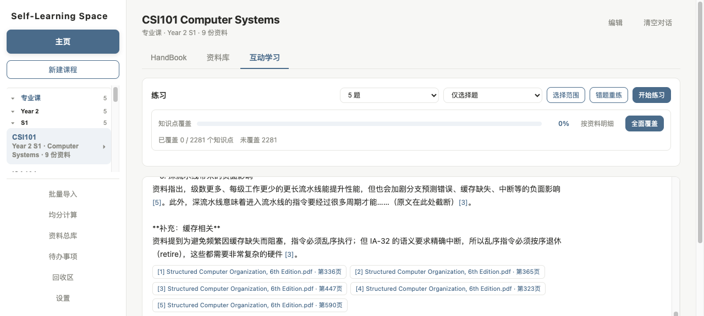
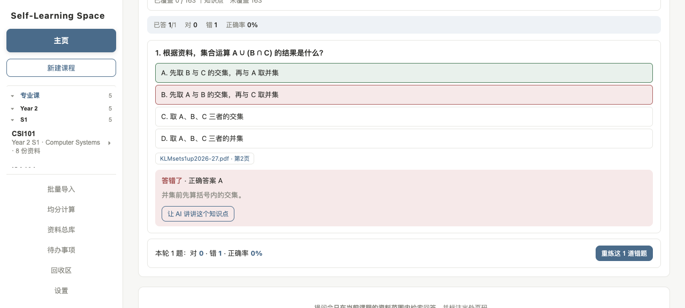
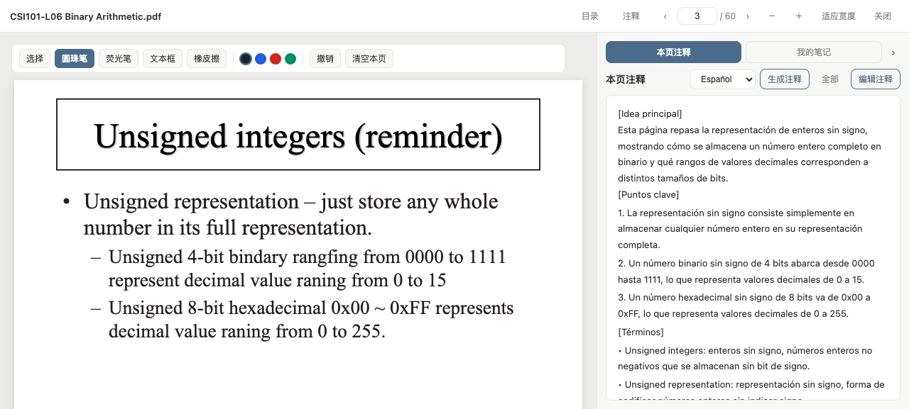
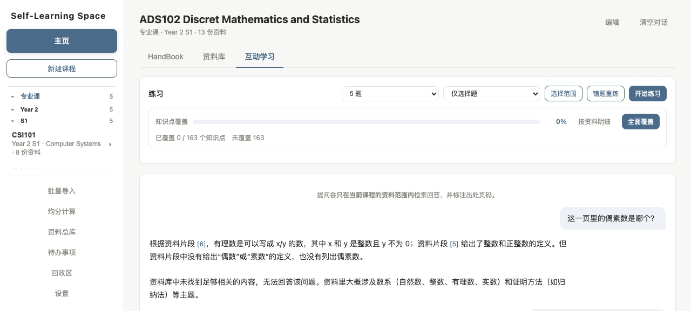

# Self-Learning Space · 本地 AI 学习助手

**中文** | [English](README.en.md)

一个**完全本地运行**的课程学习工作台：把 PDF/Word 课件按课程整理入库，基于自己的资料做**精准问答**（RAG，标注出处页码，检索不到就明说，不编造），并在阅读器里做圈画、批注、AI 逐页注释。

> 定位：给自己的「第二大脑」。数据全部留在本机（SQLite + 文件），只有调用大模型时才联网。

## 它解决什么问题

真实的痛点场景：一门课的课件是**英文 PDF**，但我习惯用**中文提问**。通用 AI 助手会：
- 不知道课程讲到哪、用了什么教材
- 回答不标注依据，无法核对
- 问它「这份课件里怎么讲的」时，它靠的是训练数据而不是我的资料

这个工具的核心就一件事：**回答必须来自你的资料，且能点着出处跳到原文那一页。**

## 功能

| 模块 | 说明 |
|---|---|
| **课程与资料管理** | 按课程代码组织，支持 PDF / docx / doc（旧版 .doc 用系统 textutil 自动转 docx），批量导入（含 zip 包），标签分类（讲义/习题/往年卷…），回收区可恢复；导出支持单份直接下载 / 多份打包 |
| **RAG 精准问答** | 混合检索（向量 + 词面）+ 中文术语映射，回答附 `[n]` 出处，点击跳转到 PDF 对应页；资料不足时**明确拒答**而非编造。支持「讲 L01 的重点」这类按资料点名的问法。输入框旁的「允许外部资料」= **真的联网搜索**（搜狗/Bing，无需 API key），网页摘要作为第二路材料标 `[W1]`，与课件冲突时以课件为准 |
| **AI 逐页注释** | 每页自动生成要点与考点，可手工编辑。**注释一律中文**——原文是英语或西班牙语都译成中文讲解，外语只保留在「原文术语」一段（原词 + 中文解释）|
| **阅读器** | PDF：圈画（圆珠笔/荧光笔）、页面上加文本框、目录跳转、内嵌书签、每份资料独立笔记。Word：按段落加批注（锚定段落序号而非像素，滚动/缩放都不错位） |
| **练习闭环** | 出题是**独立页面**（与「批量导入」同级，可按课程切换），出题分**基础 / 标准 / 挑战**三档（默认标准），每题还会按「答对需要想几步」自标 `易 / 中 / 难`；选择题点选即判分，简答题先自己写再看参考答案、自评「写出来了 / 没写出来」同样计入台账；错题按「最近一次仍错」判定、答对自动移出；答错可「让 AI 讲讲这个知识点」，带着**完整选项、你选的那项、正确答案**跳回该课程问答，AI 针对具体错项讲解 |
| **错题本** | 跨课程汇总「最近一次作答仍错」的题，按**课程 → 资料**分组，能看到错题集中在哪份 PDF 的第几页。每题标出你选的项与正确项、可展开看解释，点「去原文」直接跳回该页；重做答对后这道题自动移出清单（判定同练习闭环）|
| **全库内容搜索** | 资料总库的搜索框同时搜**文件名与正文**：输入即时走词面匹配（毫秒级、零成本），词面搜不到时按 **Enter 走语义检索**（“我记得课件里讲过，但记不清用的什么词”这种场景只有语义能中）。命中显示资料名 · 页码 · 上下文并高亮关键词，点一条直接跳那一页 |
| **薄弱点排行** | 错题本顶部按**资料正确率**排行（错题本只有分子，这里补上分母）：错 7 道是从 8 道里错的、还是从 40 道里错的，复习优先级完全不同。答过不足 3 道的标「样本太少」不参与排名 |
| **知识图** | 每门课一张概念图，可长期维护：节点可拖动摆位、双击改字、增删，点节点跳到资料那一页。连线自由但必须选类型（属于 / 依赖 / 对比）。AI 只负责起草原图（每份资料 5–8 个节点、最多 3 层），之后这张图归你 |
| **速查表** | 每门课一份四段速查页（术语 / 公式 / 代码模板 / 易错点），每条挂页码可跳原文；应用内随手改，一键导出 A4 PDF（PyMuPDF 本地排版，不依赖浏览器） |
| **番茄钟** | 绑定课程（进过哪门课就自动带出，可改），只记完整走完的；统计本周各课投入时长，休息单独计、不算学习时长 |
| **覆盖率台账** | 把资料切成知识点单元并记录哪些出过题；覆盖率随勾选范围实时重算（出题、作答、切课程、换范围都会刷新），跨轮累积 |
| **汇编训练**（CSI101） | **17 道填空题 · 73 个空**：给完整代码骨架，只挖掉关键那一行，填一行指令即可（对齐课程 Assessment 的考法）。9 道取自 Lab01–04 与 Assessment，2 道排序（冒泡 / 选择），6 道自编（统计负数 / 数组加一 / 移位算三倍 / 绝对值和 / 遇到零就停 / 双数组比较）——平均 3–4 行一个空，长题挖得更密；自编题只换场景，指令与寄存器严格限定在 lab 出现过的范围内。判分是**逐空精确比对**（忽略大小写、空白、逗号两侧空格），对/错/「指令对但操作数错」三态就地标注，错空旁边直接显示正确答案与原因，不依赖模型、不用等、可逐条复核 |
| **SQL 训练**（SOE101） | **47 道题**：三值逻辑求值（6）、数据库概念多选（6：DDL / DML / DCL、主键与唯一键、外键规则、数据类型合法性）、**写语句填空（22：建表/类型、INSERT INTO、UPDATE SET、DELETE FROM、ALTER ADD、REFERENCES 自引用外键、组合 UNIQUE、NOT EXISTS、HAVING、LIMIT、AS 别名、IN 子查询、LIKE 通配、ORDER BY DESC、ON DELETE CASCADE…）**、给表算结果（13：画出 R/S 两张关系 + 一条查询，选「哪些行在结果里」7 道，填「返回几行 / 数字」6 道）。判分本地逐项比对，选择题按选中集合完全一致才算对，不调模型 |
| **学习辅助** | HandBook 手册、考核构成记录、加权均分计算、待办清单 |

### 汇编训练：题库在哪、为什么只对两门课开放、怎么开到你自己的课

这块和其它功能不一样 —— 它**不依赖资料，也不调用模型**，题库是写死在代码里的：

| 文件 | 内容 |
|---|---|
| `backend/asm_tasks.py` | 9 道（Assessment + Lab01–04），以及判分用的归一化逻辑 |
| `backend/asm_extra.py` | 8 道自编题（换场景不换知识点），由上一行在文件末尾 `extend` 进来 |
| `backend/routers/asm.py` | 接口：取题、逐空判分、进度 |
| `frontend/views-asm.js` | 页面与「提交检查」交互 |

判分是**逐空精确比对**（忽略大小写、空白、逗号两侧空格），不调模型 ——
所以别人 clone 下来，**不需要 API Key、不需要上传任何资料、断网也能做**。
作答记录存在 `asm_attempts` 表，随数据库一起创建。

**但默认只对 `CSI101` / `CPT101` 开放。** 白名单在两个地方各写了一份：

```python
# backend/routers/asm.py
ASM_COURSE_CODES = {"CSI101", "CPT101"}

# frontend/views-asm.js
const ASM_CODES = ["CSI101", "CPT101"];
```

课程代码不在这两个里时：接口返回 `{"supported": false, "tasks": []}`，
**「汇编训练」入口按钮完全不显示**（不是灰掉，是根本不出现）——
所以别的课程看不到这个功能，不是坏了，是没开。

要开到自己的课，两条路任选：

1. **改课程代码**：把这门课的 code 改成 `CSI101` 或 `CPT101`（最省事）
2. **改白名单**：上面两处一起加，比如 `{"CSI101", "CPT101", "COMP121"}`（两处必须同步，
   只改后端会出现「按钮不显示但接口有题」）

加自己的题，照 `backend/asm_tasks.py` 里的结构写一条就行：

```python
{
    "key": "唯一标识",
    "title": "题名",
    "level": "easy | medium | hard",
    "source": "出处（显示在题头）",
    "brief": "这道题练什么",
    "decls": "C 侧声明 / 进入 _asm 前的状态",
    "parts": [{"label": "片段名", "code": "用 ____ 表示要挖的空"}],
    "blanks": [                      # 与 ____ 出现顺序一一对应
        {"accept": ["可接受的写法", "另一种写法"],
         "hint": "卡住时给一句提示",
         "why": "填错时解释为什么不对"},
    ],
    "note": "全对之后给的机制说明",
}
```

`accept` 里的写法都会被归一化后比较，所以 `"cmp eax,ebx"` 和 `"CMP EAX, EBX"` 等价。

**内容口径**：这套题按 CSI101 的课程口径写（MSVC 内联汇编 `_asm`、32 位 x86），
指令集严格限定在 Lab01–04 出现过的范围内（`mov lea push pop add sub inc dec cmp
test shl shr sar xor neg xchg loop jmp jcc call` + `EAX EBX ECX EDX ESI EDI`）。
学着 ARM / MIPS / 64 位汇编的课，题面不对口，需要按同样的结构另写一套。

## 界面预览

**问答必须标注出处，点一下跳到原文那一页：**



**练习闭环：点选即判分，答错的那道题可以「让 AI 讲讲这个知识点」—— 从测验回到学习：**



**逐页注释一律输出中文** —— 原文是英语或西班牙语都译成中文讲解，外语只保留在「原文术语」一段（原词 + 中文解释）：



**覆盖率：把「这门课复习了多少」变成可量化的数字：**



## 快速开始

```bash
git clone git@github.com:Terrence20070515/Self-study_AI_Assistant.git
cd Self-study_AI_Assistant

python3 -m venv .venv && source .venv/bin/activate
pip install -r requirements.txt

# 配置 API Key（二选一）
cp .env.example .env        # 方式一：填进 .env
export DEEPSEEK_API_KEY=sk-xxx   # 或直接给环境变量
# 方式二：启动后在界面右上角「设置」里填（存本地 data/config.json）

python launcher.py          # 桌面窗口（pywebview）
# 或
bash start.sh               # 浏览器模式
```

首次启动会自动下载向量模型（约 250MB，本地 ONNX 推理，之后离线可用）。

> 需要 Python 3.10+。桌面窗口模式依赖系统 WebView（macOS 自带；Linux 需 `webkit2gtk`）。

## 技术设计

### RAG 链路

```
PDF/docx（含 .doc 转换后）解析 → 分块(600字滑窗/重叠100) → 向量化(384维多语言模型)
             → 混合检索(向量0.72 + 词面0.28) → 阈值过滤 → DeepSeek 生成(附 [n] 引用)
```

**防幻觉的两道设计**：
- 严格模式下 system prompt 明确「只依据资料片段回答，禁止使用资料之外的知识」
- 检索分数低于阈值时，直接返回「资料库中未找到足够相关的内容」，**不给模型编造的机会**

### 几个值得说的技术决策

**1. 向量模型：从中文专用换成多语言**

最初的选型是 `BAAI/bge-small-zh-v1.5`（中文专用）。但我的库里资料以英文为主、提问却是中文，实测跨语言检索严重掉分：

| 提问 | 中文模型 | 多语言模型 |
|---|---|---|
| 中文「什么是外键」 | 0.464（勉强） | **0.530** |
| 中文「外键的作用」 | 0.469 | **0.508** |
| 英文「How to create a table?」 | 0.794 | **0.826** |

**同样的意思、同样的资料，只是把问题换成中文，相似度就掉 30%。**

**结论**：资料语言 ≠ 提问语言时，必须用多语言模型。换模型后需要**全量重编码**（维度从 512 变 384，新旧向量无法拼成矩阵）。

**2. 为什么是「混合检索」而不是纯向量**

向量检索对精确术语不敏感——问 `3NF`、`FOREIGN KEY`、`B+ tree` 这类词，纯向量经常召回语义相近但术语不对的内容。所以加了词面重合度打分：

```python
final = 向量相似度 × 0.72 + 词面重合度 × 0.28
```

其中中文提问会通过一张**中英术语对照表**补出英文写法（外键 → foreign key），让词面信号在跨语言场景也能起作用。

**3. 文字选择：删掉自实现，交回浏览器原生**（三次返工的教训）

这个功能我迭代了三次：

1. 第一次「完全选不中」→ 以为是 WebView 兼容性 → **真因是文字层坐标矩阵写错**
2. 第二次「选得不准」→ 以为是判定阈值不好 → **真因是我实现的只是「块级选择」，达不到原生字符级精度**
3. 第三次**做减法**：删掉自己写的约 100 行，让事件完全不拦截，交回浏览器 —— **一次到位**

**教训**：**动手前先问「浏览器原生是不是已经支持」**。我在重造一个更差的轮子，还用 `preventDefault()` 把原生方案挡住了。

**4. PDF 文字层的两个几何坑**

文字层是「透明文字覆盖在位图上」的实现，位置算错会有很反直觉的后果：

- **矩阵乘法写错** → 文字层整体偏移 → 选择和圈画全部失效
- **盒子高度按「基线往上一个字高」定位** → 盒子比视觉文字高，**和上一行的盒子重叠** → 拖选时动不动往上多选一行
- **字宽不匹配 PDF 原始宽度** → 相邻块**水平方向互相重叠** 5~15px → 鼠标落进重叠区就选不准

后两个的修法：盒子上沿对齐文字视觉顶部（0.82 倍字高）、用 `scaleX` 把每块压到 PDF 原始宽度（这也是 pdf.js 官方 textLayer 的做法）。

### 目录结构

```
backend/
  core.py         RAG 主链路：解析 → 分块 → 向量化 → 检索 → 生成
  store.py        SQLite 数据层
  routers/        按域拆分的 HTTP 接口
frontend/         无框架多模块前端（原生 JS）
docs/screenshots/ README 用的界面截图
tools/            回归脚本（知识点单元一致性 / 练习闭环 / DDL 解析）
data/             运行期数据（课件、数据库、配置）—— 已 gitignore
launcher.py       pywebview 桌面窗口
```

## 已知限制

- **扫描版 PDF（纯图片）不支持**，需要 OCR 才能入库
- **Word 文档的圈画 / 页图需要额外一步**：docx 走 HTML 渲染（没有固定分页），
  段落批注没问题，但「页面上任意拖框」「荧光笔圈画」「看原页图」依赖分页。
  装了 LibreOffice 后跑 `tools/convert_docx_batch.py` 会转出 PDF，
  之后与 PDF 完全同构；不装则只有段落批注
- 分块是固定长度滑窗，单个块可能从句子中间开始；检索时会把命中块的前后各扩一块、
  按 ord 拼回并裁掉重叠来补偿，但没有做语义边界切分
- 检索没有重排序（rerank）环节，`top_k` 直接取前 N
- 跨语言（中文提问 + 英文资料）依赖 `_TERM_MAP` 里维护的术语对照，覆盖不到的专业词
  仍可能检索不到
- 回答质量取决于检索命中率与所配模型的能力
- **汇编训练只对 `CSI101` / `CPT101` 开放**，其它课程连入口都不显示；
  题库写死在 `backend/asm_tasks.py`，加课 / 加题的方法见上文同名小节

## 数据与隐私

- 所有数据（课件、数据库、笔记、聊天记录）**只存在本机 `data/` 目录**，拷走该目录即完整备份
- API Key 支持 `.env` 环境变量或界面内填写，不存在代码里
- 除调用大模型 API 外，全程离线（向量模型本地推理）

## 平台支持

| 平台 | 状态 |
|---|---|
| macOS | ✓ 主要开发平台 |
| Windows | ✓ 浏览器模式用 `start.bat`；桌面模式需 WebView2（Win11 自带，Win10 需安装） |
| Linux | ✓ 桌面模式需 `webkit2gtk` |

```bash
python launcher.py      # macOS / Linux 桌面窗口
start.bat               # Windows 浏览器模式
```

## License

MIT
